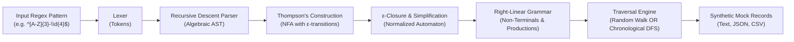

# GrammarMock 🎲📐
> **Automata-Driven Procedural Mock Data Generator**

[]()
[]()
[](LICENSE)

Standard data generators often struggle when developers need highly specific, localized string formats (such as proprietary employee IDs, serial numbers, or specialized SKU codes). Developers are often forced to write brittle, custom randomization scripts.

**GrammarMock** solves this by leveraging formal **automata theory**. By converting standard Regular Expressions into formal **Right-Linear Grammars (RLG)** via Thompson's NFA construction and $\epsilon$-reduction, GrammarMock procedurally generates thousands of synthetic strings that are **mathematically guaranteed to be 100% compliant** with the original validation rules.

Now supporting both **Random Procedural Generation** and **Chronological / Sequential Enumeration**!

---

## ⚡ How It Works



1. **Ingestion**: The user provides a standard regular expression (e.g. `^[A-Z]{3}-\d{4}$`).
2. **AST Generation**: A hand-crafted lexer and recursive descent parser parse algebraic operators (concatenation, alternation, repetition, character classes) into an AST while rejecting non-regular extensions.
3. **Thompson's Construction**: The AST is translated into a Non-Deterministic Finite Automaton (NFA).
4. **Grammar Conversion**: States and transitions are converted into a formal Right-Linear Grammar ($A \to aB$, $A \to \epsilon$).
5. **Procedural Traversal**:
   - **Random Mode (default)**: Guided random walk with cycle-depth tracking, backwards-BFS exit biasing, and deterministic PRNG seeding.
   - **Chronological Mode (`-c`, `--chronological`)**: Canonical Shortlex enumeration (shortest strings first, then alphabetical/lexicographical order like `AAA-0000`, `AAA-0001`, `AAA-0002`...).

---

## 🚀 Quick Start

### Installation

```bash
cd C:/Users/perey/Documents/GitHub/grammarmock
npm install
npm run build
```

### CLI Usage

```bash
# Random Generation (default)
node bin/grammarmock.js "^[A-Z]{3}-\d{4}$" -n 5

# Chronological / Sequential Generation (-c or --chronological)
node bin/grammarmock.js "^[A-Z]{3}-\d{4}$" -n 5 -c
# Output:
# AAA-0000
# AAA-0001
# AAA-0002
# AAA-0003
# AAA-0004

# Generate 1000 sequential records, verify 100% regex compliance, and export to CSV
node bin/grammarmock.js "^SKU-[0-9]{4}-[A-Z]{2}$" -n 1000 -c -f csv -o data.csv --verify

# Inspect AST and formal Chomsky production rules
node bin/grammarmock.js "^[A-Z]{2}\d{3}$" -n 2 --show-ast --show-grammar
```

### CLI Options

| Flag | Short | Default | Description |
|---|---|---|---|
| `<pattern>` | | *(required)* | Regex pattern to generate mocks for |
| `--count` | `-n` | `10` | Number of records to generate |
| `--chronological`| `-c` | `false` | Generates records in chronological / sequential order |
| `--sequential` | | `false` | Alias for `--chronological` |
| `--order` | | `random` | Mode: `random`, `chronological`, or `sequential` |
| `--format` | `-f` | `text` | Output format: `text`, `json`, or `csv` |
| `--output` | `-o` | `stdout` | Destination file path |
| `--seed` | `-s` | `random` | PRNG seed for reproducible test fixtures (random mode) |
| `--max-repeat` | `-m` | `5` | Repetition bound for unbounded quantifiers (`*`, `+`) |
| `--verify` | | `false` | Verifies every generated string against native RegExp |
| `--show-ast` | | `false` | Prints the Abstract Syntax Tree |
| `--show-grammar` | | `false` | Prints the formal Right-Linear Grammar productions |
| `--raw-grammar` | | `false` | Displays raw grammar including unit transitions |

---

## 💻 Programmatic API

You can also use GrammarMock directly inside your TypeScript/Node.js projects:

```typescript
import { generateMock, generateBulk } from 'grammarmock';

// 1. Random generation
const randomEmp = generateMock('^[A-Z]{3}-\\d{4}$');
console.log(randomEmp); // "KBF-7819"

// 2. Chronological / Sequential generation
const sequentialEmps = generateBulk('^[A-Z]{3}-\\d{4}$', 3, {
  mode: 'chronological',
});
console.log(sequentialEmps);
// [ "AAA-0000", "AAA-0001", "AAA-0002" ]
```

---

## 🧪 Testing

```bash
npm test
```

---

## 📜 License
MIT
