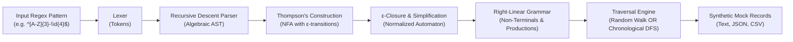

# GrammarMock 🎲📐
> **Automata-Driven Procedural Mock Data Generator**

[]()
[]()
[](LICENSE)

Standard data generators often struggle when developers need highly specific, localized string formats (such as proprietary employee IDs, serial numbers, or specialized SKU codes). Developers are often forced to write brittle, custom randomization scripts.

**GrammarMock** solves this by leveraging formal **automata theory**. By converting standard Regular Expressions into formal **Chomsky Type-3 Right-Linear Grammars (RLG)** via Thompson's NFA construction and $\epsilon$-reduction, GrammarMock procedurally generates synthetic strings that are **mathematically guaranteed to be 100% compliant** with the original validation rules.

Supports both **Random Procedural Generation** and **Chronological / Sequential Enumeration**!

---

## ⚡ How It Works



1. **Ingestion**: Provide any standard regular expression (e.g. `^[A-Z]{3}-\d{4}$`).
2. **AST Parsing**: A recursive descent parser builds an algebraic AST (concatenation, alternation, repetition, character classes).
3. **Thompson's Construction**: Translates the AST into a Non-Deterministic Finite Automaton (NFA).
4. **Grammar Conversion**: Converts states and transitions into a formal Right-Linear Grammar ($A \to aB$, $A \to \epsilon$).
5. **Procedural Traversal**:
   - **Random Mode (default)**: Guided random walk with cycle-depth tracking, backwards-BFS exit biasing, and deterministic PRNG seeding.
   - **Chronological Mode (`-c`, `--chronological`)**: Canonical Shortlex enumeration (shortest strings first, then alphabetical/lexicographical order: `AAA-0000`, `AAA-0001`, `AAA-0002`...).

---

## 📖 Instructions: How to Use Data Generation

You can generate mock data using any of the three interfaces:
1. **[Interactive Web Studio](#1-interactive-web-studio)** (Visual workbench with live graph and export)
2. **[Command-Line Interface (CLI)](#2-command-line-interface-cli)** (Terminal scripts, CI/CD, and file exports)
3. **[Programmatic API](#3-programmatic-api-typescript--nodejs)** (Embedded directly in TypeScript / Node.js test suites)

---

### 1. Interactive Web Studio

The Web Studio provides a split-pane technical workbench for real-time regex testing, automata visualization, and data export.

#### Step 1: Launch the Studio
```bash
# Install dependencies
npm install

# Start the local development server
npm run dev
```
Open `http://localhost:5173` (or `http://127.0.0.1:5173`) in your browser.

#### Step 2: Define Pattern
- **Custom Pattern**: Enter any regular expression in the left-hand editor (e.g. `^[A-Z]{3}-\d{4}$`).
- **Presets**: Pick from categorized industry presets via the header dropdown:
  - *Identity & HR*: Employee ID, Email Handle
  - *Commerce & Inventory*: Product SKU, Credit Card, Invoice ID
  - *Software & Dev*: UUID v4, SemVer 2.0, API Route, Hex Color
  - *Network & Infra*: IPv4 CIDR, MAC Address, ISO Date

#### Step 3: Configure Parameters
- **Mode**:
  - `Random`: Stochastic random-walk generation.
  - `Chronological`: Deterministic sequential enumeration (Shortlex order: `AAA-0000`, `AAA-0001`, `AAA-0002`...).
- **Count**: Number of records to generate (e.g. `25`, `100`, `1000`).
- **Max Repeat**: Repetition upper bound for unbounded quantifiers (`*` and `+`). Prevents infinite loops.
- **PRNG Seed**: *(Optional)* Enter an integer seed to reproduce the exact same random output across runs.

#### Step 4: Generate Records
- Click the **GENERATE** button or press <kbd>Cmd</kbd> / <kbd>Ctrl</kbd> + <kbd>Enter</kbd>.
- The **Data Stream** tab displays the generated mock records with:
  - Line numbers and real-time substring search/filter.
  - Length distribution and Shannon entropy metrics.
  - **100% Verified** compliance badge.
- Click **Export** to copy or download as **Plain Text**, **JSON**, **CSV**, or **TypeScript** code.

#### Step 5: Explore Automata & Grammar
- **Tab 1: Automata Graph**: Interactive SVG diagram of the Thompson NFA ($q_0, q_1, \dots$), labeled transitions, step-by-step path trace, and transition matrix $\delta(q, a)$.
- **Tab 3: Grammar & AST**: Parsed AST hierarchy and formal Chomsky Type-3 productions table ($A \to aB \mid \epsilon$).

---

### 2. Command-Line Interface (CLI)

The CLI is ideal for shell scripting, database seeding, test fixtures, and automated pipelines.

#### Basic Usage
```bash
node bin/grammarmock.js "<pattern>" [options]
```

#### Common Command Recipes

##### A. Generate Random Records
```bash
# Generate 5 random employee IDs
node bin/grammarmock.js "^[A-Z]{3}-\d{4}$" -n 5
# Output:
# KBF-7819
# WXJ-0142
# MLP-9531
# TRQ-4208
# JAD-6610
```

##### B. Generate Chronological / Sequential Records
```bash
# Generate records sequentially in Shortlex order (-c or --chronological)
node bin/grammarmock.js "^[A-Z]{3}-\d{4}$" -n 5 -c
# Output:
# AAA-0000
# AAA-0001
# AAA-0002
# AAA-0003
# AAA-0004
```

##### C. Reproducible Test Fixtures with Seed
```bash
# Using the same seed guarantees identical output every time
node bin/grammarmock.js "^[A-Z]{2}\d{4}$" -n 3 --seed 42
```

##### D. Export to CSV or JSON Files
```bash
# Export 1,000 product SKUs to CSV
node bin/grammarmock.js "^SKU-[0-9]{4}-[A-Z]{2}$" -n 1000 -c -f csv -o inventory.csv

# Export 100 user tokens to JSON
node bin/grammarmock.js "^USR_[a-z0-9]{12}$" -n 100 -f json -o users.json
```

##### E. Bounding Quantifier Repetition
```bash
# Limit the '*' and '+' loops to at most 3 repetitions
node bin/grammarmock.js "^(ha)+!$" -n 5 -m 3
```

##### F. Automatic Regex Verification Check
```bash
# Verify every generated record against native RegExp fullmatch
node bin/grammarmock.js "^INV-202[0-9]-[0-9]{5}$" -n 500 --verify
# Output:
# ✔ 100% Compliance Verified (500/500 records matched /^INV-202[0-9]-[0-9]{5}$/)
```

##### G. Inspect AST & Formal Chomsky Productions
```bash
# Print AST tree and Right-Linear Grammar productions
node bin/grammarmock.js "^[A-Z]{2}\d{2}$" --show-ast --show-grammar
```

#### CLI Options Reference

| Option | Flag | Default | Description |
|---|---|---|---|
| `<pattern>` | | *(required)* | Regular expression pattern (e.g. `"^[A-Z]{3}-\\d{4}$"`) |
| `--count` | `-n` | `10` | Number of mock records to generate |
| `--chronological`| `-c` | `false` | Generates records sequentially (canonical Shortlex order) |
| `--sequential` | | `false` | Alias for `--chronological` |
| `--order` | | `random` | Generation mode: `random`, `chronological`, or `sequential` |
| `--format` | `-f` | `text` | Output format: `text`, `json`, or `csv` |
| `--output` | `-o` | `stdout` | Destination file path (defaults to console output) |
| `--seed` | `-s` | `random` | Integer PRNG seed for deterministic output (random mode) |
| `--max-repeat` | `-m` | `5` | Maximum loop depth for unbounded quantifiers (`*`, `+`) |
| `--verify` | | `false` | Validates every generated string against native RegExp fullmatch |
| `--show-ast` | | `false` | Displays the parsed Abstract Syntax Tree |
| `--show-grammar` | | `false` | Displays the formal Right-Linear Grammar productions |
| `--raw-grammar` | | `false` | Displays raw grammar including $\epsilon$-unit transitions |

---

### 3. Programmatic API (TypeScript / Node.js)

Embed GrammarMock directly in your application or automated test suites (e.g., Vitest, Jest).

#### Installation & Import
```bash
npm install
npm run build
```

```typescript
import { generateMock, generateBulk, compileGrammar } from 'grammarmock';
```

#### A. Generate Single Record
```typescript
// Generate a single string matching the regex
const employeeId = generateMock('^[A-Z]{3}-\\d{4}$');
console.log(employeeId); // "XQY-4812"
```

#### B. Generate Bulk Records (Random)
```typescript
// Generate 5 random records with a deterministic seed
const records = generateBulk('^[A-Z]{2}-[0-9]{3}$', 5, {
  seed: 12345,
  maxRepeat: 4,
});
console.log(records);
// [ "AB-120", "CD-451", "XY-902", ... ]
```

#### C. Generate Sequential Records (Chronological)
```typescript
// Shortlex enumeration (shortest first, alphabetical)
const sequentialSkus = generateBulk('^SKU-[0-9]{2}$', 4, {
  mode: 'chronological',
});
console.log(sequentialSkus);
// [ "SKU-00", "SKU-01", "SKU-02", "SKU-03" ]
```

#### D. Unit Test Fixture Example
```typescript
import { describe, it, expect } from 'vitest';
import { generateBulk } from 'grammarmock';

describe('User Service Validation', () => {
  it('validates synthetic employee IDs', () => {
    // Generate 100 deterministic mock IDs
    const mockIds = generateBulk('^[A-Z]{3}-\\d{4}$', 100, { seed: 42 });
    
    for (const id of mockIds) {
      expect(id).toMatch(/^[A-Z]{3}-\d{4}$/);
    }
  });
});
```

#### Options Interface Reference
```typescript
interface GenerationOptions {
  seed?: number;                           // Deterministic PRNG seed
  maxRepeat?: number;                      // Repetition upper bound for * and + (default: 5)
  mode?: 'random' | 'chronological' | 'sequential'; // Traversal algorithm (default: 'random')
}
```

---

## 🔠 Supported Regular Expression Syntax

GrammarMock supports the formal class of **Type-3 Regular Expressions**:

| Category | Supported Syntax | Example | Description |
|---|---|---|---|
| **Literals** | `abc`, `123`, `foo` | `test` | Exact character matching |
| **Character Sets** | `[a-z]`, `[0-9]`, `[A-Z]` | `[A-F0-9]` | Matches one character in range |
| **Inverted Sets** | `[^a-z]`, `[^0-9]` | `[^0-9]` | Matches any character not in range |
| **Shorthand Classes** | `\d`, `\w`, `\s` | `\d{3}` | Digits, word characters, whitespace |
| **Escapes** | `\.`, `\-`, `\[`, `\\` | `\.com` | Escaped special characters |
| **Quantifiers (Exact)** | `{n}` | `\d{4}` | Exactly $n$ occurrences |
| **Quantifiers (Range)** | `{min,max}` | `[a-z]{3,8}` | Between $min$ and $max$ occurrences |
| **Quantifiers (Unbounded)** | `*`, `+`, `{min,}` | `\d+`, `a*` | Repetition bounded by `--max-repeat` |
| **Optional** | `?` | `-?` | 0 or 1 occurrence |
| **Alternation** | `(a\|b)`, `(GET\|POST)` | `(com\|org\|net)` | Choice between branches |
| **Anchors** | `^`, `$` | `^[A-Z]+$` | Start and end of string anchors |

> [!NOTE]
> Non-regular regex extensions (such as lookaheads `(?=...)`, lookbehinds `(?<=...)`, and backreferences `\1`) cannot be modeled with finite state automata or Chomsky Type-3 grammars, and are intentionally rejected by the parser to guarantee mathematical correctness.

---

## 🧪 Testing

GrammarMock features a comprehensive, 3-tier test suite covering Unit, Integration, and End-to-End (E2E) testing:

```bash
# Run the entire test suite (Unit + Integration + E2E)
npm test

# Run isolated Unit Tests (Lexer, Parser, AST, NFA, Epsilon, Grammar, PRNG, Sampler, Formatters)
npm run test:unit

# Run Integration Tests (Pipelines, 100% Regex Compliance, Reproducibility, Edge Cases)
npm run test:integration

# Run End-to-End Tests (CLI process execution, Presets catalog, User workflows)
npm run test:e2e

# Run Vitest in interactive watch mode
npm run test:watch
```

### Test Suite Structure
- **Unit Tests (`tests/unit/`)**: Verifies each isolated algorithmic module with high precision (e.g. Thompson construction, ε-elimination, Chomsky production rules, Mulberry32 PRNG, Shortlex DFS order).
- **Integration Tests (`tests/integration/`)**: Validates end-to-end data pipelines from regular expression ingestion through automata transformation to mock output, including full compliance suites against native `RegExp`.
- **E2E Tests (`tests/e2e/`)**: Exercises the binary CLI executable (`bin/grammarmock.js`) via subprocess calls with all CLI flags (`-n`, `-f`, `-o`, `-s`, `-c`, `--verify`, error handling), preset catalog generations, and export workflows.

---

## 📜 License
MIT
